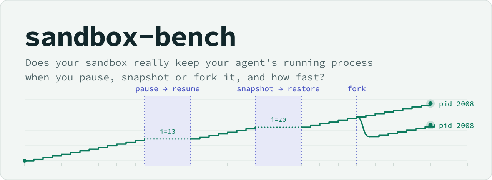
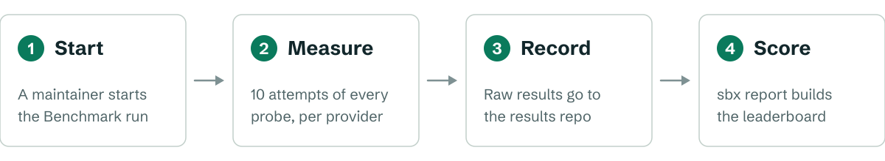
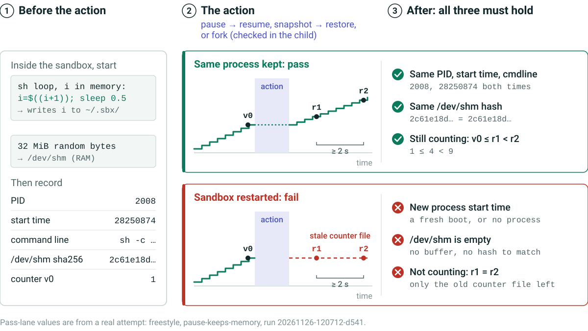
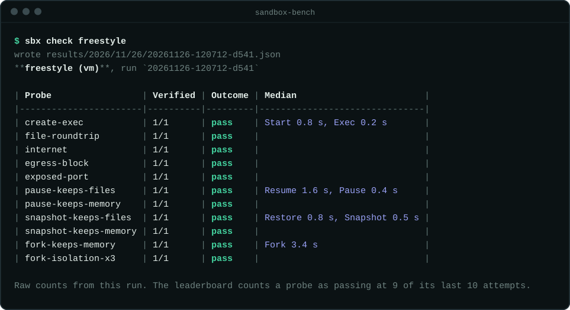

<picture>
  <source media="(prefers-color-scheme: dark)" srcset="docs/assets/hero-dark.svg">
  
</picture>

# sandbox-bench

**Does your sandbox really keep your agent's running process when you pause, snapshot or fork it, and how fast?**

sandbox-bench checks every day, with the same probes for every provider. No paid placement. Measured from one machine in us-east. Raw data in git.

> **Pre-launch.** v0.1 is being built. See the [roadmap](docs/ROADMAP.md).

## The leaderboard

*As of `<date>` · runner in us-east · every sandbox 2 vCPU / 4 GiB · illustrative numbers until the first run*

| # | Provider | Probes passed | Keeps memory on | Start | Resume | Restore | Fork | $/h running / paused |
|---|---|---|---|---|---|---|---|---|
| 1 | Provider A | 100% (11 of 11) | pause, snapshot, fork | 0.9 s (snapshot) | 0.3 s | 0.8 s | 1.1 s | 0.13 / 0.01 |
| 2 | Provider B | 64% (7 of 11), failing: egress-block | pause | 0.4 s (pool) | 0.6 s | 2.4 s | n/a | 0.17 / 0.02 |
| 3 | Provider C | 55% (6 of 11) | none | 1.6 s (cold) | n/a | 1.8 s | n/a | 0.17 / n/a |

**How to read it:**
- **Probes passed:** the share and count of the 11 probes that passed at least 9 of their last 10 attempts. "Failing" names probes the provider offers that passed less often. The rest aren't offered.
- **Keeps memory on:** the operations after which the agent's running process was still alive and counting.
- **Times:** medians of the last 10 attempts, shown only when the probe behind the column passes. "n/a" means not offered, and "failing" means offered but not passing. Resume and Restore are timed on the files probes; "Keeps memory on" says whether the process survived too.
- **Start:** **pool** = handed out from a pre-started pool, **snapshot** = booted from a saved memory snapshot, **cold** = fresh boot.
- **$/h:** list price for one sandbox running, or paused, for an hour.

## How the score works

A probe passes when at least 9 of its last 10 attempts succeed. A provider's score is the share of the 11 probes it passes, shown with the count (e.g. 64%, 7 of 11). Every probe weighs the same, and providers rank by that score, with ties going to the faster Start. A probe that is offered but passes less often is named as failing, and one that isn't offered is n/a; both count as zero. A time column shows a number only when the probe behind it passes.

Each daily run makes 5 attempts per probe, so "the last 10" covers about two days. Each run's full report adds per-column rankings, p90s, sample counts, plan, size and region. The [methodology](docs/METHODOLOGY.md) has the exact clock boundaries.

<picture>
  <source media="(prefers-color-scheme: dark)" srcset="docs/assets/how-a-run-works-dark.svg">
  
</picture>

*How a daily run reaches the leaderboard. The machine's setup is in [RUNNER](docs/RUNNER.md).*

## The probes (v0.1)

| Probe | Passes when | Shows up as |
|---|---|---|
| `create-exec` | A new sandbox runs a command and returns its output | Start |
| `file-roundtrip` | A 10 MiB random file reads back with the same hash | |
| `internet` | A pinned file downloads with the expected hash | |
| `egress-block` | With outbound traffic denied, a connection fails | |
| `exposed-port` | A web server inside the sandbox answers from outside | |
| `pause-keeps-files` | After pause and resume, the files are intact | Resume |
| `pause-keeps-memory` | After pause and resume, the same process is still running and counting | Keeps memory on: pause |
| `snapshot-keeps-files` | A sandbox restored from a snapshot has the files | Restore |
| `snapshot-keeps-memory` | A sandbox restored from a snapshot has the same process, still counting | Keeps memory on: snapshot |
| `fork-keeps-memory` | A fork of a running sandbox has the parent's process, still counting | Fork (time to the fork's first command), Keeps memory on: fork |
| `fork-isolation-x3` | 3 forks run, and a file written in one is invisible to the others | |

<picture>
  <source media="(prefers-color-scheme: dark)" srcset="docs/assets/memory-check-dark.svg">
  
</picture>

*The memory check behind the three `-keeps-memory` probes ([methodology §3](docs/METHODOLOGY.md#3-the-memory-check)).*

Got an idea for a probe? [Propose it](CONTRIBUTING.md#propose-a-probe), especially for the feature you're proudest of.

## Run it yourself

From a checkout (a PyPI release comes with v0.1):

```bash
uv sync
uv run sbx check fake                                   # offline: try the harness, no account
uv run sbx check daytona                                # every probe, with your own key
uv run sbx check freestyle --probe pause-keeps-memory   # just one
uv run sbx run --providers daytona,freestyle --out runs # a full run, as the daily job does it
uv run sbx report runs --out board                      # score run records into tables
```

Keys come from environment variables only, e.g. `DAYTONA_API_KEY`.



*Real output from a Freestyle run on 2026-11-26.*

Results you produce are yours to compare. The published tables come only from our runner.

## Add your provider

1. Copy `src/sandbox_bench/providers/_template.py` to `src/sandbox_bench/providers/<you>.py`. Implement `create`, `exec` and `destroy`, plus whatever pause, snapshot or fork you offer.
2. Run `sbx check <you>` with your own key, and paste its table into a PR.
3. After merge, we run your provider daily from our machine, on your free tier or on credits you give the project. It appears on the leaderboard once each probe has 10 attempts.

Details are in [CONTRIBUTING](CONTRIBUTING.md#add-your-provider).

## Contribute

Propose a probe in an issue with a one-sentence pass condition, or open a PR. A fake provider runs every probe offline, so `uv run pytest` needs no cloud account. One maintainer approval merges a PR. Start with [CONTRIBUTING](CONTRIBUTING.md).

## Rules

- **Same harness and rules for everyone.** No paid placement, and the raw data is public.
- **Like for like.** Default settings on a public plan. A pre-started pool or a snapshot boot counts when it's the provider's standard start at no extra cost; a warm pool you pay to keep idle doesn't. Plan and actual size are listed with each provider's results.
- **Any public mechanism counts.** For example, a fork made by snapshotting and restoring N copies passes the fork probes. The mechanism is listed with the provider's results.
- **"Offered" means your docs claim it.** A probe whose exact behaviour your public docs describe is tested, and can't be marked n/a.
- **Providers are welcome.** You can maintain your own adapter and add a short note to your results. Probe changes are announced in an issue 7 days before they count.
- **Something looks wrong?** Open a [dispute](https://github.com/sandboxrouting/sandbox-bench/issues/new). Every failing probe links to its evidence and the command that reproduces it.
- **Adapters need an owner.** An adapter broken for 14 days is marked `stale`. If it stays broken, it is removed.

## Why

There are more than 15 sandbox providers for AI agents, and the features agents depend on most are the hardest to compare: pause and resume with memory intact, snapshots, forks, and cost while idle. Launch posts and docs pages don't settle it, so we measure.

## Docs

- [Methodology](docs/METHODOLOGY.md): probes, clock boundaries and scoring, on one page
- [Threats to validity](docs/METHODOLOGY.md#9-threats-to-validity): every known way these results could mislead
- [Decisions](docs/decisions/README.md): each judgement call, with the alternatives we didn't take
- [Contributing](CONTRIBUTING.md): add a provider, a probe or a fix
- [Roadmap](docs/ROADMAP.md): what's being built and what's next
- [Landscape research (Nov 2026)](docs/research/landscape-2026-11.md)

## License

[Apache 2.0](LICENSE)
