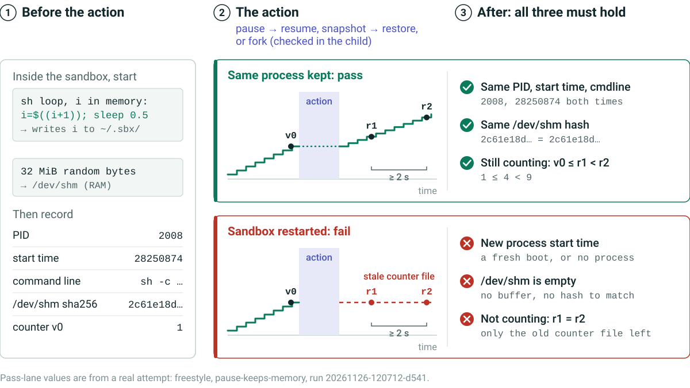

# Methodology

Everything about how sandbox-bench measures, on one page. If this page and the code disagree, the code wins, and the mismatch is a bug worth filing.

## 1. Setup

- **Sandbox size:** 2 vCPU / 4 GiB RAM. Where a provider has fixed shapes, we use the nearest one at or above this, and each row shows the actual size.
- **Environment:** the provider's default image and settings. A pre-started pool counts when the provider runs it for everyone at no extra cost; a warm pool billed while idle doesn't. Probes bring their own tools and need only `sh` with the usual core utilities (`head`, `cut`, `sha256sum`), `/proc` and a writable `/dev/shm` inside the sandbox. The network probes also need one of `python3`, `curl`, `wget` or `nc` (see "Pinned details" below). A missing tool fails a probe; it never passes one.
- **Runner:** one fixed machine in us-east. Each provider uses its region nearest the runner, shown in its row.
- **Accounts:** any public plan a new customer can sign up for: a free tier, credits, or pay-as-you-go ([ADR-0006](decisions/0006-paid-plans-allowed.md)). Each row shows its plan, and any account tier that changes what a probe sees.
- **Cadence:** one run per day, with 5 attempts per probe. Providers are interleaved in a shuffled order, with one operation in flight at a time. Each run starts with one uncounted warm-up create per provider.

## 2. Probes

A probe is a pass/fail check judged by a verifier. One **action** (for example "pause, then resume") can yield several probe verdicts, and each attempt also records its timings.

| Probe | Action | Passes when |
|---|---|---|
| `create-exec` | create a sandbox, run `echo` | The output is correct |
| `file-roundtrip` | write, then read a 10 MiB random file | The SHA-256 matches |
| `internet` | download a pinned file from a public CDN | The SHA-256 matches |
| `egress-block` | create with outbound traffic denied, try to connect out | The connection fails |
| `exposed-port` | start an HTTP server, call it via the provider's URL or port | It answers from the runner |
| `pause-keeps-files` | pause, then resume | The test file's hash matches |
| `pause-keeps-memory` | pause, then resume | The memory check (§3) passes |
| `snapshot-keeps-files` | snapshot, then create from it | The test file's hash matches |
| `snapshot-keeps-memory` | snapshot, then create from it | The memory check (§3) passes |
| `fork-keeps-memory` | fork once | The memory check (§3) passes in the child |
| `fork-isolation-x3` | fork three times, write a marker in one child | All 3 children run, and the marker is invisible to the parent and the other children |

**Pinned details:**
- Test files live under `$HOME/.sbx`, not `/tmp`, which is in RAM on some images.
- `internet` downloads [jQuery 3.7.1 from cdnjs](https://cdnjs.cloudflare.com/ajax/libs/jquery/3.7.1/jquery.min.js) (87,533 bytes, SHA-256 `fc9a93dd241f6b045cbff0481cf4e1901becd0e12fb45166a8f17f95823f0b1a`) with `curl`, else `wget`, else `python3`.
- `egress-block` sends one plain HTTP request to `cdnjs.cloudflare.com:80` and one to `1.1.1.1:80` (by name and by IP, since blocking DNS alone doesn't block traffic), with 5 s timeouts, using `python3`, else `curl`. It passes only when both were tried and neither sent back a single response byte. A completed TCP handshake with no response counts as blocked, because some providers accept connections and then drop the traffic. Any response, or no tool to try with, doesn't.
- `exposed-port` serves a random token on port 8080 with `python3 -m http.server`, else an `nc` loop. The runner sends a GET to the provider's URL for up to 30 s, and passes when the token comes back.
- `fork-isolation-x3` forks 3 children in one call, writes the marker in the first, and looks for it in the parent and the other two.

**Outcomes:**
- **pass:** at least 9 of the last 10 attempts verified. Detail tables show the count, e.g. "9/10".
- **failing:** the provider offers the feature, but it passed fewer than 9 of the last 10 attempts.
- **n/a:** not offered, because the provider's public docs don't claim this behaviour.
- **pending:** fewer than 10 attempts so far.

**What counts as offered:**
- "Offered" is decided **per probe**. If the docs claim a snapshot keeps files but not memory, `snapshot-keeps-files` is offered and `snapshot-keeps-memory` is not.
- Each adapter lists its offered probes, each with a link to the docs that claim it.
- **Any public mechanism counts.** For example, a fork made by snapshotting and then creating copies passes the fork probes. The mechanism used is shown with the provider's results.

## 3. The memory check

Before the action, the harness starts a counter inside the sandbox: a plain `sh` loop that keeps `i` in memory and writes it to a file every 0.5 s. It also fills a 32 MiB buffer in `/dev/shm`, which lives in RAM. The harness then records:
- the loop's PID and process start time (`/proc/<pid>/stat`);
- its command line;
- the buffer's hash;
- the last counter value, `v0`.

After the action, the check passes only if all of these hold:
1. The same PID is running, with the same start time and command line.
2. The `/dev/shm` buffer has the same hash.
3. Two counter reads taken ≥ 2 s apart show `v0 ≤ r1 < r2`. The process is alive, continued from where it was, and is still counting. A process frozen while paused passes, because it resumes counting.

A restarted sandbox fails, because it has a new process start time and an empty `/dev/shm`. A stale counter file also fails, because the counter isn't rising.

<picture>
  <source media="(prefers-color-scheme: dark)" srcset="assets/memory-check-dark.svg">
  
</picture>

## 4. Timings

All timings are client-side wall clock, taken by the harness around adapter calls. They never come from numbers the provider reports. **"Ready" always means a command succeeded inside the sandbox:** the harness runs `echo` every 0.1 s until it prints its output, within the operation's timeout.

| Metric | Clock starts | Clock stops | Column shown only if this passes |
|---|---|---|---|
| Start | before the create call | first `echo` succeeds | `create-exec` |
| Exec | before a `true` exec | it returns (median of 5 per attempt) | `create-exec` |
| Pause | before the pause call | the call returns | `pause-keeps-files` |
| Resume | before the resume call | first command succeeds | `pause-keeps-files` |
| Snapshot | before the snapshot call | the snapshot is usable | `snapshot-keeps-files` |
| Restore | before create-from-snapshot | first command succeeds | `snapshot-keeps-files` |
| Fork | before the fork call (including any snapshot step) | first command succeeds in the child (a fork of one) | `fork-keeps-memory` |
| API RTT | before a trivial authenticated API call | it returns | none (context only) |

**Which attempts become samples:**
- the attempt succeeded;
- it used a default create, so probes created with egress denied never feed Start;
- it carried the same payload as every other provider's attempts.

**Timeouts** are per operation and the same for every provider:

| Operation | Timeout |
|---|---|
| create, restore, resume, fork | 120 s |
| exec | 60 s |
| snapshot | 15 min |

A timeout is a failure, never a capped sample. Any rate-limit pacing happens outside the clock.

**Start mode** (pool, memory or cold) is declared by the adapter. At the first exec, the harness also records `/proc/uptime` and the boot ID as evidence.

## 5. Scoring and ranking

- **Main table:**
  - Rows are ranked by score (the share of probes passed), with ties broken by Start p50.
  - The score is probes passed ÷ probes in the version (11 in v0.1), shown as a percentage with the count, e.g. "64% (7 of 11)". Every probe weighs the same.
- **Speed columns:**
  - Each shows the median (p50) of the last 10 attempts. Fork is the time to the first command in one fork.
  - A provider appears in a column only if it passes that column's probe.
  - A column with fewer than 10 samples is shown but not ranked.
- **Keeps memory on** lists pause, snapshot and fork when the matching memory probe passes. A files-only resume can't be mistaken for a full one.
- **State columns** (Resume, Restore, Fork) rank only sandboxes at the standard 2 vCPU / 4 GiB. Memory size changes these timings.
- **Per-metric tables** add p90, n, success rate, the date window, plan, size, region and API RTT.
- **Per-provider facts:** each provider gets a plain line generated from data, for example "Pause: not offered. Snapshot: files only, 368 s."
- **Errors:**
  - Provider errors (5xx responses, timeouts, wrong results) count as failures.
  - Our own errors (a harness bug, an expired key, exhausted credits, an account limit) are excluded and listed in the run log.
  - Every failing probe links to its error, the verifier's evidence and the `sbx check` command that reproduces it.

## 6. Cost

Prices come from `pricing/pricing.yaml`, where each rate has its source link and the date it was checked.

- **$/h running:** list price for one 2 vCPU / 4 GiB sandbox running for an hour.
- **$/h paused:** list price for keeping that sandbox paused for an hour (storage and any fees). It is n/a when pause isn't offered.

Per-creation fees, billing minimums and monthly platform fees are shown with the provider's results.

## 7. Cleanup

- Every resource the harness creates is named `sbx-<run_id>-…`.
- A reaper deletes leftovers matching that prefix before and after every run.
- It never touches anything else on the account.

## 8. Versioning

The benchmark has one version, starting at `v0.1`. Adding or changing a probe, a clock boundary or the scoring bumps it, after a 7-day notice in an issue. Scores are compared only within one version. SDK versions are pinned, and upgrades go through PRs.

## 9. Threats to validity

Every known way these results could mislead, in the four standard categories. Each entry says what we do about it and what remains. Where a threat comes from a choice, it links the decision record in [`decisions/`](decisions/README.md). New workarounds and judgement calls are added here in the same PR (CONTRIBUTING).

### 9.1 Construct validity: do the probes measure what they say?

| Threat | What we do | What remains |
|---|---|---|
| **"Offered" is our reading of the docs.** A probe is n/a unless the docs claim it, and some claims are indirect. | Every offered probe links the page that claims it. | Freestyle's `fork-isolation-x3` rests on a guide that implies isolation without stating it ([ADR-0005](decisions/0005-freestyle-fork-isolation-offered.md)). A dispute can move a probe either way. |
| **The egress check is a sample, not a proof.** | Two targets, by name and by IP, and only a response counts as open ([ADR-0004](decisions/0004-egress-needs-a-response.md)). | Only TCP port 80 over IPv4 is tried. A block that leaves other ports, UDP or IPv6 open still passes. |
| **Network probes depend on tools in the image.** | `curl`, `wget`, `python3` or `nc`, whichever exists; the tool is in the evidence ([ADR-0008](decisions/0008-network-probes-use-image-tools.md)). | An image without any of them fails the network probes even if its network works. |
| **"Keeps memory" is tested on one small process.** | One `sh` loop and a 32 MiB `/dev/shm` buffer, checked for identity, content and progress (§3). | Large heaps, many processes, open sockets and GPU state aren't tested. |
| **A mechanism stands in for a missing operation.** | Any public mechanism counts, and it is shown with the results (§2). | Fork through snapshot-then-create is timed end to end, so it isn't comparable to a native fork's internals, only to what a user waits for. |

### 9.2 Internal validity: is it the provider, or us?

| Threat | What we do | What remains |
|---|---|---|
| **The adapter shapes the result.** A slow or wrong mapping makes the provider look slow or broken. | Public SDK or REST API only, pinned versions, no retries or caching, an owner per adapter, and each provider gets its results 7 days before launch (ROADMAP §3). | Where no Python SDK exists, the adapter calls REST directly (Freestyle), and a provider's own SDK might be faster or slower. |
| **Adapter workarounds.** | Each is a decision record, linked from the code. | Daytona builds a new SDK client after 240 s idle, so a dropped keep-alive connection doesn't fail the next sandbox ([ADR-0002](decisions/0002-daytona-fresh-client-after-idle.md)). |
| **Errors are sorted by adapters.** An `AccountError` is excluded, anything else fails the provider (§5). | Each adapter maps HTTP status codes and messages, with tests. | The mapping can be wrong. Daytona's adapter counts HTTP 429 (rate limited) as our error, Freestyle's doesn't. An excluded attempt is listed in the run log, so this is visible but not scored. |
| **Client-side clocks include the path to the provider.** | API RTT is measured and shown as context, and the runner sits in us-east near each provider's chosen region. | Providers farther from us-east pay more network time on every call. Readiness polls every 0.1 s, so times are coarse to about 0.1 s. |
| **Pacing, warm-up and pools.** | Pacing is outside the clock. One uncounted warm-up create per provider per run. A free shared pool counts; a billed warm pool doesn't (§1). | A pool-backed Start isn't a cold start, which the start mode column states. |

### 9.3 External validity: how far the results carry

| Threat | What we do | What remains |
|---|---|---|
| **One runner region.** | Each provider uses its region nearest us-east, shown in its row. | Results from Europe or Asia may differ, in latency and in which pools are warm. |
| **One size, default image, default settings.** | 2 vCPU / 4 GiB, or the nearest shape above, shown in the row. | Larger sandboxes, custom images and tuned settings can behave differently, especially for snapshot, restore and fork. |
| **One account and plan per provider.** | Any public plan, stated in the row ([ADR-0006](decisions/0006-paid-plans-allowed.md)). | Account tiers change behaviour. Our Daytona account behaves like Tier 3+; on Tier 1/2, `internet` and `egress-block` would fail. |
| **One operation at a time, short-lived sandboxes.** | Shuffled, sequential, about two days of attempts per window. | No burst or concurrency load, and pauses last seconds, not hours (`pause-1h-resume` is planned for v0.2). |
| **One time of day.** | The run starts at 06:00 UTC daily. | Providers loaded at other hours may be slower or less reliable than shown. |

### 9.4 Conclusion validity: are the numbers solid enough?

| Threat | What we do | What remains |
|---|---|---|
| **9 of 10 is a small sample.** | The threshold and window are fixed for everyone and shown with each verdict. | A probe that truly succeeds 90% of the time shows as passing only about 74% of the time; at 95%, about 91%; at 99%, more than 99%. One bad day can flip a verdict. |
| **Medians of 10 samples are noisy when times vary widely.** | p50 and p90 are shown with n and the date window. | Daytona's snapshot time ranged from 7.6 s to 449 s in testing. With 10 samples, p90 is close to the single slowest value. |
| **Early results.** | Columns with fewer than 10 samples are shown but not ranked. | Numbers from a single `sbx check` (one attempt per probe) are examples, not results. |
| **Prices are list prices.** | Each has a source link and a checked date; an unpublished price shows as "?" ([ADR-0007](decisions/0007-unknown-prices-stay-unknown.md)). | Billing minimums, discounts and what a paused sandbox actually bills may differ from the list price. |
